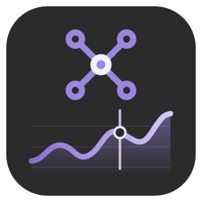

<p align="center"></p>

# FlightLogger

**Version 0.1.0** (first release, see the [update log](#update-log)).

> **Note:** all the code in this repository is entirely AI generated. Version 0.1.0 is
> developed and tested on **Ubuntu 22.04**. The last state tested on **Ubuntu 24.04** is kept in
> the branch `Last-tested-Ubuntu-24.04`; the dependency versions are pinned (PySide6 6.11.x,
> QtAds 5.1.1) to avoid an exit crash with PySide6 6.12.0. Ongoing development happens in the
> branch `Development-Ubuntu-22.04`; `main` holds the released versions.

Desktop viewer for PX4 `.ulg` flight logs. It reproduces
[Flight Review](https://github.com/PX4/flight_review)'s graphs offline and adds
what a review session with a ground-camera video needs: synced video, notes,
undo, graph editing and a layout you can spread over several screens.


*A PX4 log with its ground-camera video synced: video with notes and PX4
warnings drawn over it (left), Flight Review graphs with a note span and the
selected plot framed (center), track and notes (right), whole-flight timeline
(bottom). The lavender dark theme follows the look of OmniQuadGUI; a light theme
is one click away.*

## What it adds to Flight Review

**Flight Review parity**
* The same graphs (topics, derived values, titles, legends, colors, per-log
  conditions), generated locally from the `.ulg`, so no upload is needed and it
  works offline. Open a Flight Review link and the original log is fetched for you.

**Synced flight video**
* Plays any phone/camera format (MP4, MOV, HEVC, H.264, VP9, AV1, ...), with
  slow motion down to 0.05x, frame stepping and fullscreen on any screen.
* One red cursor drives graphs, timeline, track and video together. Sync by hand
  with one moment, or add a second point to correct camera/flight-controller clock drift.
* The video progress bar is clickable and shows small ticks for your notes and the
  PX4 warnings; notes and log messages can also be drawn over the picture (one
  semi-transparent box each, with a soft flash at the exact timestamp or for the whole
  length of a span). The **Timing** and **Size** menus set how long notes show before and
  after their time and how large the overlay text is.

**Notes on the timeline**
* Timed notes and spans (with categories and custom colors) plus general untimed
  notes, shown on every graph and the timeline. Hover a marker for a preview.
* Export all notes with their timestamps as a text file.

**Dock and layout freedom**
* Graph panels, track, messages, parameters and lists can be split, tabbed or torn
  off onto other screens. Save named layouts and whole sessions as project files.
* One-click graph presets (positions, angles, angular rates, actuators, raw
  sensors, power) for new panels, and isolate any plot in its own floating window.
* *Link X* off lets you zoom a single plot on its own; switching it back on
  realigns everything.

**Editing and export**
* Edit a plot's title and each series' color, thickness, line style and visibility,
  and keep the changes in the project.
* Export a plot as a light-mode PNG for papers; the export dialog has a one-click
  white background.
* Light and dark themes, switched with one button.

**Comfort**
* Undo / redo (Ctrl+Z / Ctrl+Shift+Z) for notes and plot changes, Canc deletes the
  selected note or plot, a toolbar with the common commands, and the plot you last
  clicked is framed. **Help → About** shows the version.

The graph set is ported from [PX4 Flight Review](https://github.com/PX4/flight_review)
(BSD-3-Clause, see `flightlogger/log/FLIGHT_REVIEW_LICENSE.md`): same topics,
derived values, titles, legends, colors and per-log conditions. Not ported yet:
the VTOL state band, tailsitter attitude conversion, the map, and decoded
`event` messages.

## Setup (Ubuntu 22.04 / 24.04)

```bash
./install.sh
```

Installs the system packages it needs (asks for sudo only if some are missing:
`libmpv1` on 22.04 / `libmpv2` on 24.04, `libxcb-cursor0`, `python3-venv`),
creates `.venv`, installs the Python dependencies and adds FlightLogger to the
applications menu. Requires Python 3.10+ (22.04 ships 3.10, 24.04 ships 3.12).

## Run

```bash
./flightlogger.sh [path/to/log.ulg]
```

## Opening logs

* **File → Open log** (Ctrl+O), or drop a `.ulg` on the window.
* **File → Open Flight Review link** (Ctrl+L): paste a link such as
  `https://review.px4.io/plot_app?log=<id>` (logs.px4.io and self-hosted Flight
  Review servers work too), or drag the link from the browser onto the window.
  The original `.ulg` is downloaded once to `~/.cache/flightlogger/logs` and
  opened; projects remember the link and download it again if the file is gone.

Warnings and errors that PX4 logged appear as dotted markers on the graphs and
the timeline (hover for the text; the timeline right-click menu toggles warnings,
notes, flight events and flight modes). **View → Log messages on graphs** switches
between off, errors, warnings and errors (default), and all messages.

## Video sync

Open a video with **File → Open video** (Ctrl+Shift+O) or drop it on the window
(MP4, MOV, M4V, 3GP, MKV, WebM, AVI; H.264, HEVC, VP9, AV1, ...). Then:

1. Uncheck **Linked** in the Video panel.
2. Put the video on a recognizable moment (scrub bar, ←/→ frame steps).
3. Put the log cursor on the same moment: click a graph, or choose an event
   (Takeoff, Armed, warnings, ...) in **Jump log to**.
4. Press **Sync here**. Video and log are linked again.

Fine-tune with **−1f / +1f** (the video frame stays, the log cursor moves) or
type the offset.

Camera and flight controller clocks drift slightly apart. For long flights,
add a **second sync point** late in the flight: unlink, line up another
recognizable moment, and press **Add 2nd point**. FlightLogger then corrects
the drift between the two points (shown under the sync controls; **Reset drift**
goes back to a single point). While the video plays it drives the cursor; before it starts
and after it ends, the log keeps playing on its own. ⛶ (or double-click)
shows the video fullscreen on the screen its panel is on; Esc leaves.

The Video panel can be resized, moved to any side of the main window or tabbed,
but not torn off into its own window yet; every other panel (graphs, track,
messages, parameters, lists, timeline) can float in separate windows, alone or
grouped, on any screen. Floating windows are ordinary desktop windows: they have
minimize, maximize and close buttons, appear in the taskbar and can be placed
anywhere, also outside the program. To dock one along a whole side of the main
window, drag it onto the edge of the window (the edge arrows appear) or use
**Window → Dock floating window to window edge**.

Closing a graph panel only hides it: the **Window** menu lists every graph panel
(closed or floating ones are marked) to bring it back, and has **Delete graph
panel**, **Bring floating windows to front** and **Dock all floating windows**.
Closing an isolated plot window removes that copy.

## Notes

Press **N** (or **Note** in the Notes panel) to add a note at the red cursor.
Give it a title, a category (Info, Maneuver, Anomaly, Crash, Question) or a custom
color, and a comment. **Set end** (or **Ctrl+N** with the note selected) turns it
into a span. **General** adds an untimed note about the whole flight. Notes show
as colored markers on every graph and the timeline (hover for a preview; switch
it off in **View → Note previews on hover**); click one in the list to jump there.
**Export** (or File → Export notes as text) writes all notes with their timestamps
to a text file. In the **Video** panel, the *Notes* / *Messages* buttons under the
progress bar draw them over the picture: an instant note appears shortly before its time
and stays a few seconds after; a span stays for its whole length. **Timing ▾** sets how
long notes appear before and stay after (default 1.5 s and 4 s) and **Size ▾** sets the
text size; both are remembered.

## Projects and layouts

**File → Save project** (Ctrl+S) writes a `.flproj` file with the log, the
video and its sync offset, the notes, the cursor and zoom, the graph panels
and the window layout. Paths are stored relative to the project (move or share
the whole folder) and as absolute paths (move just the project file).
**File → Open project** (Ctrl+Shift+P) restores everything; if a file moved,
you are asked to locate it. Closing with unsaved notes or sync asks to save.

**View → Layouts** saves the current arrangement (graph panels and their graphs,
dock positions, floating windows on each screen, window size) under a name and
re-applies it with any log. One layout can be used at startup; **Reset to
default layout** brings back the standard arrangement. Windows saved on a
monitor that is no longer connected come back to the main screen. Layouts are
stored in `~/.config/flightlogger/layouts`.

## Keys

| Key | Action |
| --- | --- |
| Space | Play / pause |
| ← / → | One video frame (0.1 s without video); Shift: 1 s, Ctrl: 10 s |
| `[` / `]` | Slower / faster (0.05× … 4×) |
| Home / End | Start / end of log |
| N / Ctrl+N | Add a note at the cursor / set the selected note's end at the cursor |
| Canc | Delete the selected note, or the plot you last clicked |
| Ctrl+Z / Ctrl+Shift+Z | Undo / redo (notes and plot changes) |
| Ctrl+O | Open log |
| Ctrl+L | Open Flight Review link |
| Ctrl+Shift+O | Open video |
| Esc | Leave fullscreen video |
| Ctrl+S / Ctrl+Shift+S | Save project / save as |
| Ctrl+Shift+P | Open project |
| Ctrl+G | New empty graph panel (presets are in the **New panel** menu) |

Click or drag on any graph or the timeline to move the cursor. The **Graphs**
list ticks the Flight Review graphs shown in the active panel; drag graphs onto
any panel to place them. Drag raw signals from **Signals** onto a plot (adds to
it) or onto empty space (new plot). Click a row in **Messages** to jump there. Right-click a plot to edit it
(colors, lines), export it as a light image, isolate it in its own window or remove it.
Panels can be split, tabbed, or torn off into floating windows on other screens.

## Update log

Newest first. Versions follow `MAJOR.MINOR.PATCH`: patch = bug fixes, minor = new features that
keep old projects working, major = breaking changes (0.x = still in development).

### 0.1.0 (first release)
First tagged version, after the development phase. Includes everything described above:
* Flight Review graphs generated offline from `.ulg` logs, Flight Review links, PX4 warning markers.
* Synced flight video with one- and two-point sync, slow motion, frame stepping, fullscreen.
* Timed notes, spans and general notes with categories and colors, export as text, notes and
  messages drawn over the video with Timing and Size menus.
* Dockable panels, floating windows, saved layouts and project files.
* Plot editing, isolate plot, light PNG export, graph presets, undo/redo, light and dark theme,
  Help → About.
* Fixes in this release: clicking a legend entry no longer moves the cursor; the Positions preset
  hides the barometer altitude; exit crash on Ubuntu 22.04 fixed by pinning PySide6 and QtAds.
